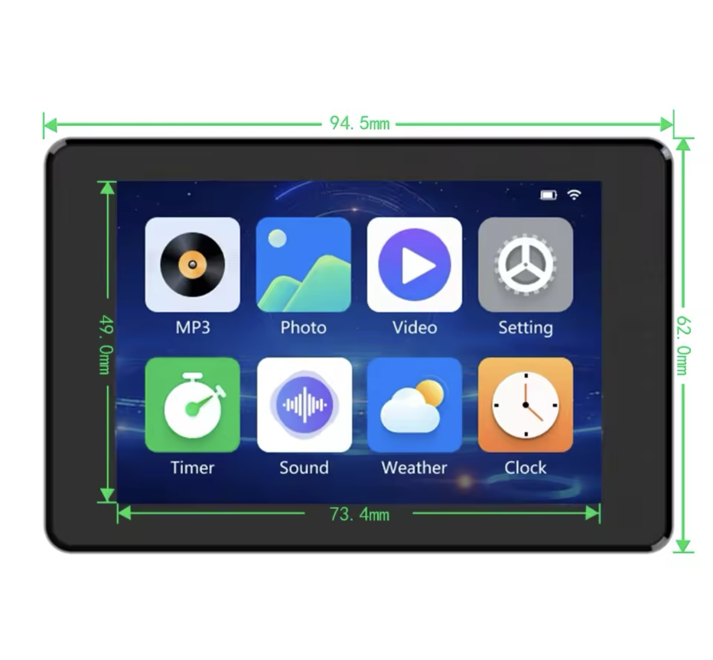
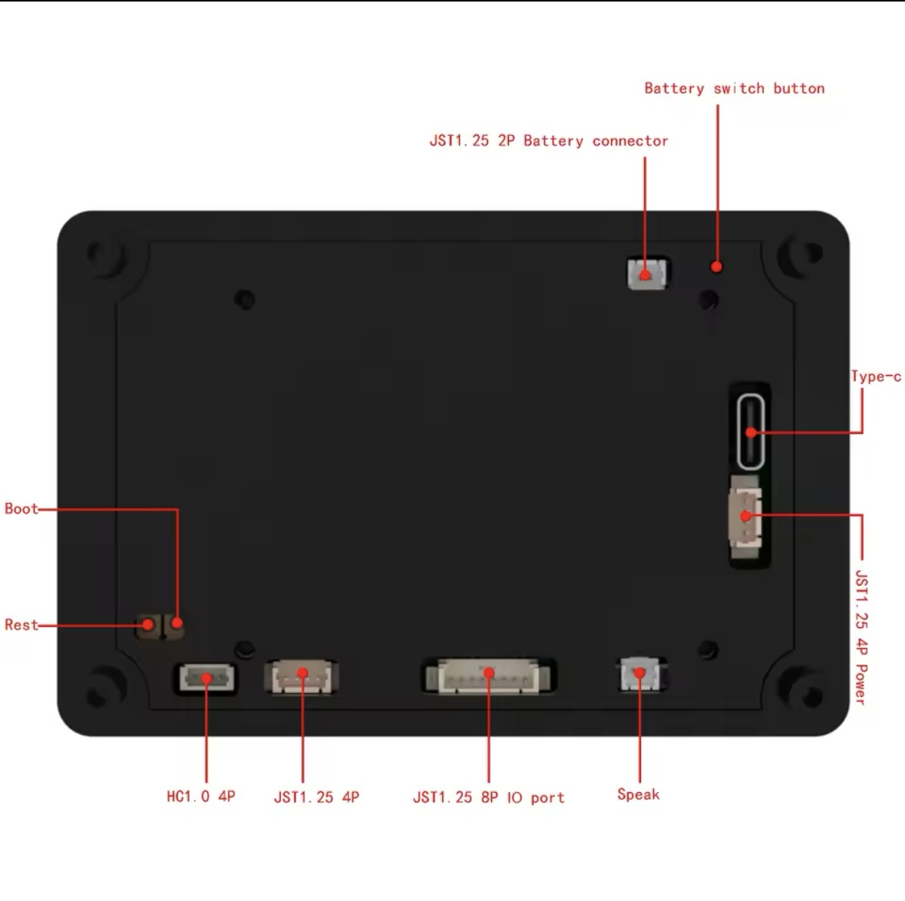

# This is a platformio based build of the JC3248W535EN DEMO_LVGL Package

I had downloaded the zip file from the manufacturer, but had a really hard time getting it to build in VSCode/PlatformIO so I thought I would share my build to help others get started with the board.

The current build targets PlatformIO's Espressif32 platform 8.0.0 (ESP-IDF 6.1.0) and LVGL 9.6.0. It uses ESP-IDF rather than Arduino because the display and touch drivers rely on ESP-IDF APIs.

Build the project with PlatformIO using the `LVGL-320-480` environment.

For this board from https://s.click.aliexpress.com/e/_DFO5uIV